# BOQ Tracker: database design

| | |
|---|---|
| **Document** | Design for moving the BOQ Tracker from one Excel file per project to a database |
| **Status** | Draft for review, 2 Nov 2026; updated 6 Nov 2026 (editable stages, BOQ editor, rate analysis). Nothing in this document is built yet. |
| **App version today** | 2.0 (pywebview desktop app, Python standard library only, Excel `.xlsx` trackers) |
| **Owner** | M-Structures |
| **Readers** | Owner and management (sections 1–3, 9, 12–13, 17), developers (all), IT / whoever runs the system (sections 10–11, 14–15) |

**Contents**

1. [Summary](#1-summary)
2. [Where we are today](#2-where-we-are-today)
3. [Goals, non-goals and assumptions](#3-goals-non-goals-and-assumptions)
4. [Key decisions](#4-key-decisions)
5. [Architecture](#5-architecture)
6. [Data model and ERD](#6-data-model-and-erd)
7. [Main flows](#7-main-flows)
8. [Calculations and the data layer](#8-calculations-and-the-data-layer)
9. [BOQ editor and stages](#9-boq-editor-and-stages)
10. [Backup and disaster recovery (SQLite)](#10-backup-and-disaster-recovery-sqlite)
11. [Security and access](#11-security-and-access)
12. [Migrating from SQLite to PostgreSQL](#12-migrating-from-sqlite-to-postgresql)
13. [Cost comparison](#13-cost-comparison)
14. [Saturday-only use](#14-saturday-only-use)
15. [Migrating today's Excel trackers](#15-migrating-todays-excel-trackers)
16. [Testing](#16-testing)
17. [Phased plan](#17-phased-plan)
18. [Risks](#18-risks)
19. [Open questions](#19-open-questions)
20. [Appendix A: SQLite DDL](#appendix-a-sqlite-ddl)
21. [Appendix B: SQLite → PostgreSQL type map](#appendix-b-sqlite--postgresql-type-map)
22. [Appendix C: glossary](#appendix-c-glossary)

---

## 1. Summary

Today every project lives in its own Excel tracker. That works for one person and a few projects, but it does not give a view across projects, it cannot be used by several people at once, and the history of changes lives in side files (`.changes.csv`, `.revisions.json`, `.backups\`).

This design moves the data into a database, in two steps:

1. **Now: SQLite on the data-entry PC.** It is built into Python, so the `.exe` needs no new packages and costs nothing to run. The app becomes the place where data is entered; Excel trackers become an **export**.
2. **Later: PostgreSQL on a server**, behind a small web API, when a second person needs to enter data, data has to be entered from more than one PC or site, or roles and approvals are needed.

The data is organised as you asked:

```
Client → Project → BOQ (revisions) → BOQ lines
                 → Bills, client receipts   (the tracker details)
```

with two adjustments: a BOQ has **revisions** (a revised BOQ never overwrites the signed one), and **bills belong to the project**, not to one BOQ revision, so a revision does not have to copy every bill.

The schema and code follow a short list of rules (section 12) so that moving from SQLite to PostgreSQL later is a few days of work, not a rewrite.

---

## 2. Where we are today

| Piece | Today |
|---|---|
| Storage | One `.xlsx` tracker per project, built from the BOQ by `make_tracker.py`. Bills in the `Actuals_Log` sheet, receipts in `Client_Receipts`, the BOQ in `Quote_Baseline`. |
| Entry | In Excel, or in the app (queued in `%LOCALAPPDATA%\BOQTracker\pending_*.json`, then pushed into the file). |
| Calculations | `tracker_stats.py` (budget, forecast, status, stages), `tracker_pay.py` (payments, cash for the next stage). Excel also has its own formulas. |
| History | Timestamped copies in `<tracker>.backups\`, `.changes.csv`, `.revisions.json`. |
| Locks | A file open in Excel cannot be changed by the app. |

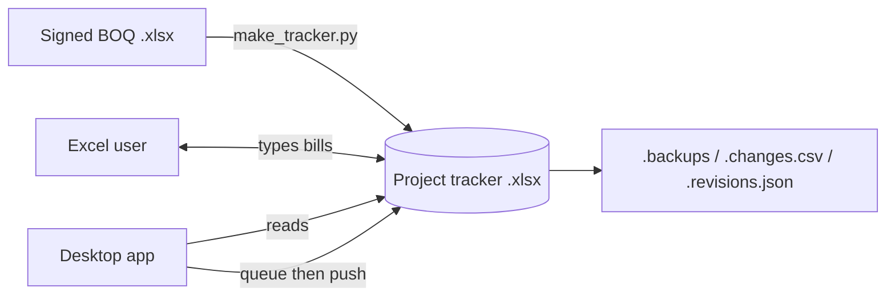

**What carries over unchanged:** the BOQ reader and checks in `make_tracker.py`, the calculations in `tracker_stats.py` and `tracker_pay.py`, the BOQ comparison in `tracker_boqdiff.py`, the screens, the Excel tracker layout (now as an export).

---

## 3. Goals, non-goals and assumptions

**Goals**

| # | Goal |
|---|---|
| G1 | Client → Project → BOQ → tracker details as real, linked records. |
| G2 | A view across all projects: margins, cash, vendor rates. |
| G3 | A full history of every change (who, when, old and new values), with undo of a single change. |
| G4 | BOQ revisions kept side by side; bills survive a revision. |
| G5 | Backups that are checked and can be restored by a non-technical person. |
| G6 | A later move to PostgreSQL with no change to screens or calculations. |
| G7 | The Excel tracker still available for the client, accounts and as an emergency copy. |
| G8 | BOQs created and edited in the app (stages, items, labour / material lines), starting from a company template with stages ST01–ST10 that each BOQ can change. |

**Non-goals (for now)**

- Two-way sync between Excel and the database. Once the database is the master, Excel is read-only output.
- Mobile app, bill photos, approval workflow. Designed for (section 6), built later.
- Accounting or GST invoicing.

**Assumptions**

- One person enters data today, mostly on **Saturdays**. The organisation may grow large.
- One Windows PC today; Windows 11 Enterprise (BitLocker available).
- Volumes: tens of projects now, hundreds later; a few hundred bills per project per year.
- Money is in INR.

---

## 4. Key decisions

| # | Decision | Why | Alternatives considered |
|---|---|---|---|
| D1 | **The database is the master.** Excel is an export. | One source of truth; no conflicts; no file locks. | DB as an index of Excel files (keeps Excel as master; no multi-user). Two-way sync (rejected: conflicts and double counting). |
| D2 | **SQLite now, PostgreSQL later.** | SQLite is built into Python: zero install, zero cost, ideal for one user. PostgreSQL when users or sites grow. | MySQL (works, but weaker constraints and no transactional schema changes). Server from day one (cost and running effort not justified for one user). |
| D3 | **PostgreSQL rather than MySQL** for the server. | Strict types, exact `NUMERIC`, `CHECK` constraints, transactional DDL, good free tooling (pgloader). | MySQL 8 is acceptable if the IT provider only supports it; the portability rules cover both. |
| D4 | **Bills belong to the project**, carry an item code, and record the BOQ revision they were entered under. | A revision does not copy bills; orphan handling stays as today. | Bills under a BOQ revision (rejected: every revision would copy all bills). |
| D5 | **Money as whole paise (`INTEGER`).** | Exact totals in every database. | `REAL` (rounding errors), `TEXT` decimals (slow, error-prone). |
| D6 | **Text IDs generated by the app** (ULID: sortable, unique). | Records can be created offline and merged later without clashes. | Auto-increment (clashes when merging offline data). |
| D7 | **One data layer** in Python; no SQL in screens or calculations. | Swapping SQLite for PostgreSQL changes one module. | — |
| D8 | **Server phase: desktop app → HTTPS API → PostgreSQL.** | The `.exe` keeps using only the standard library (`urllib`); the PostgreSQL driver lives on the server. | App connects straight to PostgreSQL (needs a driver in the exe, and opens the database to the internet). |

---

## 5. Architecture

### 5.1 Phase A: SQLite on one PC

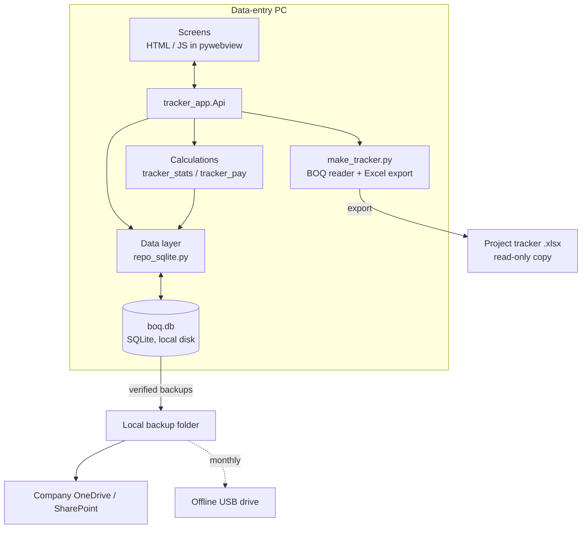

### 5.2 Phase B: PostgreSQL on a server

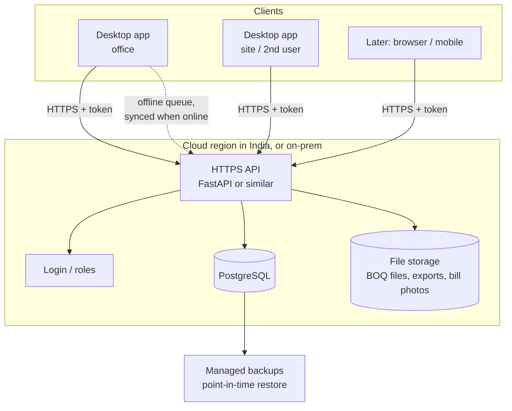

### 5.3 Layers in the code

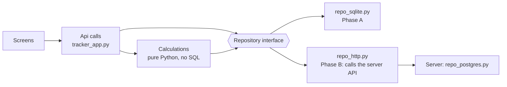

The repository interface is the only code that knows where the data lives. Phase B adds `repo_http.py` on the desktop and `repo_postgres.py` on the server; screens and calculations do not change.

---

## 6. Data model and ERD

### 6.1 Entity relationship diagram

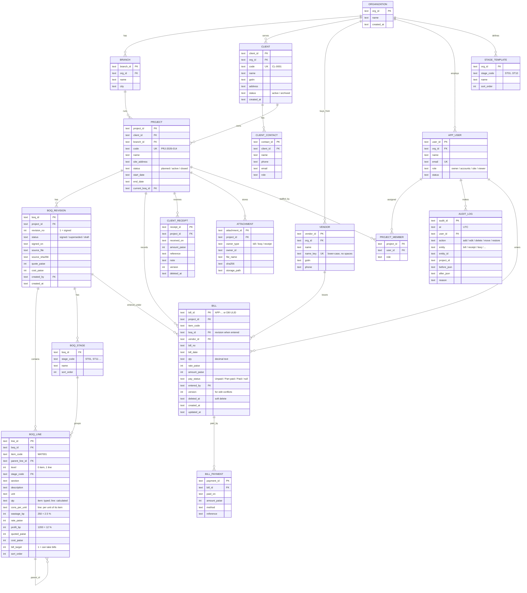

### 6.2 How the tables map to today's tracker

| Today (Excel tracker) | Database |
|---|---|
| BOQ `C1 Client Name`, `C2 Project Name` | `client.name`, `project.name` (checked against the chosen client / project on upload) |
| `Quote_Baseline` sheet | `boq_revision` + `boq_line` (one set of lines per revision) |
| BOQ column D stage, ST01–ST10 fixed in the code | `boq_stage` (each revision has its own stage list, copied from `stage_template` when a BOQ is started) |
| Line quantity formula `=F25*0.095*(1+E28/100)` | `boq_line.cons_per_unit` (0.095) and `wastage_bp` (500); the quantity is calculated |
| `Actuals_Log` row | `bill` (Bill ID kept as `bill_id`) |
| Payment status, paid, paid on (columns P–S) | `bill.pay_status` + `bill_payment` rows (one per payment, so part payments keep their history) |
| `Client_Receipts` sheet | `client_receipt` (receipt ID kept) |
| Vendor typed per bill | `vendor` (shared across projects, matched by `name_key`) |
| EXTRA / REWORK / OVERHEAD lines | `boq_line` rows with `bill_target = 1`, created with every revision |
| `.changes.csv` | `audit_log` |
| `.revisions.json`, BOQ copies in `.backups\` | `boq_revision` rows, original BOQ file kept as an `attachment` |
| Excel row number | Not stored. The Excel export lays bills out in order. |

### 6.3 Rules that keep the data correct

| Rule | Where it is enforced |
|---|---|
| Every bill's `item_code` is a bill-taking line in the project's **current** BOQ revision, or it is flagged as needing a new line (the orphan step). | Data layer, checked again after every revision update |
| `amount_paise = round(qty × rate_paise)`; never typed. | Data layer |
| `Part paid` needs at least one payment; `Paid` needs payments that add up to the amount. | Data layer + `CHECK` where possible |
| One `signed` revision per project at a time; older ones become `superseded`, never deleted. | Data layer, inside one transaction |
| Item codes are unique within a revision. | `UNIQUE (boq_id, item_code)` |
| Every line's stage exists in that revision's stage list. | `FOREIGN KEY (boq_id, stage_code) REFERENCES boq_stage` |
| A stage that has items cannot be removed until its items are moved or deleted. | Data layer (the editor asks where to move them) |
| Stage codes never change; only names and order do. A new stage takes the next free code (ST11, ST12, …). | Data layer |
| A project has at most one signed revision and one draft at a time. | Data layer + partial unique index in PostgreSQL |
| Vendor names are matched case- and space-insensitively. | `UNIQUE (org_id, name_key)` |
| Nothing is physically deleted: bills and receipts get `deleted_at`. | Data layer; reports skip deleted rows |
| Every add, edit, delete, move and restore writes an `audit_log` row in the same transaction. | Data layer |
| Two edits of the same bill: the second is refused if `version` changed since it was read. | `UPDATE ... WHERE bill_id = ? AND version = ?` |

### 6.4 Indexes

| Table | Index | Used for |
|---|---|---|
| `bill` | `(project_id, item_code)`, `(project_id, bill_date)`, `(vendor_id)` | Line totals, monthly charts, vendor views |
| `boq_line` | `(boq_id, item_code)` unique, `(boq_id, stage_code)` | Tracker table, stage figures |
| `boq_stage` | `(boq_id, stage_code)` primary key, `(boq_id, sort_order)` | Stage list in the editor and the dashboard |
| `client_receipt` | `(project_id, received_on)` | Payments page |
| `audit_log` | `(project_id, at)`, `(entity, entity_id)` | History, undo |
| `project` | `(client_id)`, `(status)` | All-projects home |

### 6.5 Size estimate

| | Now | Large organisation |
|---|---|---|
| Projects | 20 | 1,000 |
| BOQ lines per revision | ~400 | ~400 |
| Revisions per project | 1–3 | 1–3 |
| Bills per project | ~500 | ~2,000 |
| **Rows in total** | ~30,000 | ~3–4 million |
| **Database size** | a few MB | 1–3 GB |

Size never forces a server: SQLite handles this comfortably. The reasons to move are **people and places**, not data volume (section 17).

---

## 7. Main flows

### 7.1 Client onboarding

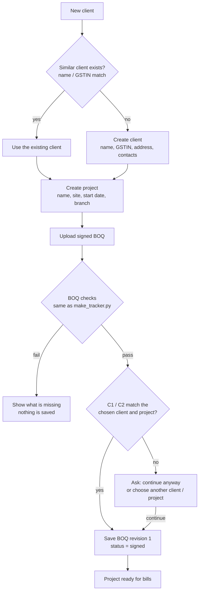

### 7.2 Entering a bill (Phase A)

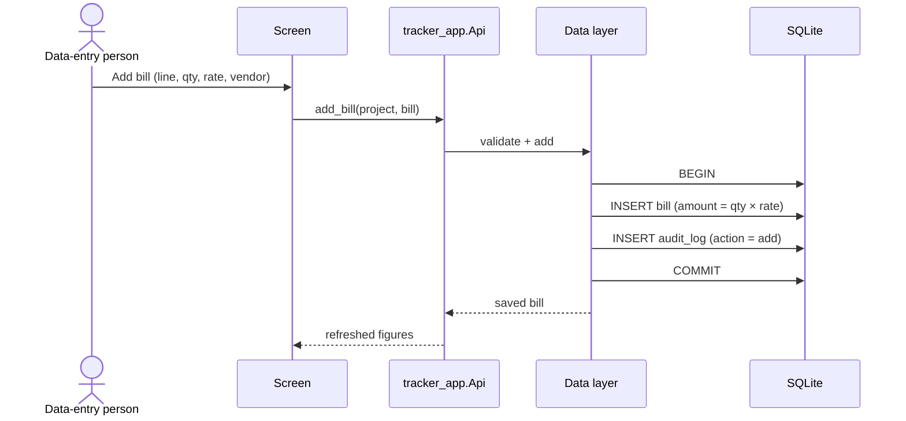

### 7.3 Editing a bill that someone else changed (Phase B)

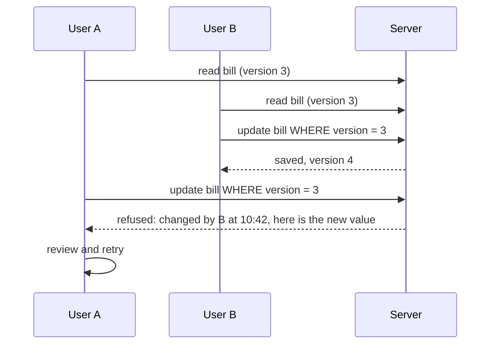

### 7.4 BOQ revision

The same flow the app has today (review → decide orphans → update → verify → undo), on database rows instead of files:

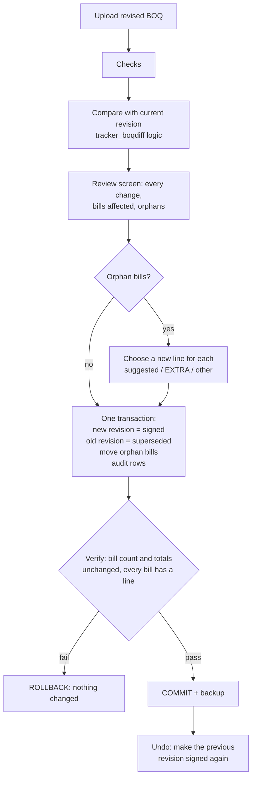

### 7.5 Lifecycle of a bill

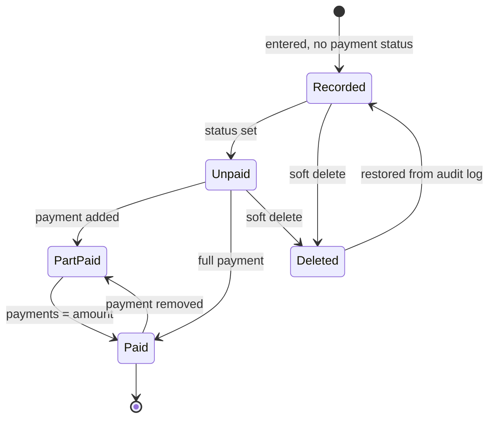

### 7.6 Saturday session

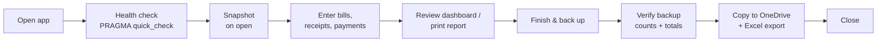

---

## 8. Calculations and the data layer

- **One copy of the business rules.** Budget (quote ÷ (1 + profit %)), forecast, status (OK / WATCH / AT RISK / OVER), stage phase, payments split and cash for the next stage stay in `tracker_stats.py` and `tracker_pay.py`. They already take plain Python lists and dicts, so the data layer only has to return the same shapes the Excel reader returns today.
- **No business logic in SQL.** SQL is used to fetch and store rows, and for simple totals in cross-project views. That keeps one copy of the rules and makes the PostgreSQL move simple.
- **Money:** stored in paise (`INTEGER`), converted to rupees only for display. Quantities stored as decimal text (for example `"3316.25"`) and read with Python's `Decimal`, so `qty × rate` is exact.
- **Repository interface (sketch):**

| Call | Returns |
|---|---|
| `list_clients()`, `get_client(id)`, `save_client(c)` | Client records |
| `list_projects(client_id=None, status=None)` | Projects with headline figures |
| `current_boq(project_id)`, `boq_lines(boq_id)` | Revision and its lines |
| `bills(project_id)`, `add_bill`, `edit_bill(bill, expected_version)`, `delete_bill` | Bills; edit refuses on version mismatch |
| `receipts(project_id)`, `add_receipt`, … | Client receipts |
| `apply_revision(project_id, new_boq, decisions)` | Runs flow 7.4 in one transaction |
| `audit(project_id, since=None)`, `undo(audit_id)` | History and single-change undo |
| `backup(label)`, `restore(path)` | Section 10 |

---

## 9. BOQ editor and stages

The BOQ is created and edited in the app instead of in Excel. A mock-up is in `mockups/boq_editor.html`.

### 9.1 Creating a BOQ for a project

1. Choose the **client**, then the **project**, from drop-downs (with "+ New client" and "+ New project" beside them).
2. If the project already has a BOQ, it opens:
   - **Draft:** opens for editing.
   - **Signed:** opens read-only, with "Start revision N+1".
   - **Several revisions:** shown as a row of chips (Rev 1 · Signed 14 Feb 2026 · Rev 2 · Draft).
3. If it has none, the user chooses how to start:

| Start from | What it does |
|---|---|
| **Company template** (default) | Stages ST01–ST10 from the company's stage list; no items |
| **Copy another project's BOQ** | Stages, items and lines copied as a new draft; rates refreshed from the rate library |
| **Import a BOQ sheet** | Today's Excel BOQ; missing IDs are created and a check screen is shown first |

4. The draft is **saved automatically** as the user works. **Signing** is a separate step: it locks the revision and makes it the tracker's budget.

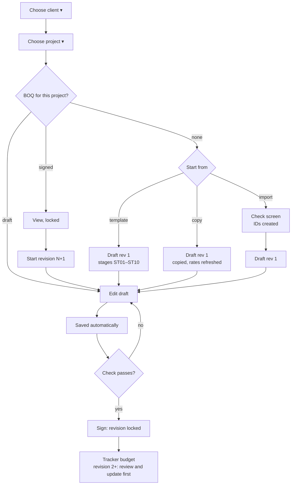

### 9.2 Stages

| Level | Who | What |
|---|---|---|
| **Company template** (`stage_template`) | Admin | The default list every new BOQ starts with: ST01–ST10 as in today's BOQ. Changing it does not change BOQs already made. |
| **This BOQ revision** (`boq_stage`) | Whoever edits the draft | Rename, add, reorder or remove stages for this project only |

Rules in a draft:

- **Rename:** changes the name only; the code stays (ST05 stays ST05).
- **Add:** gets the next free code (ST11, ST12, …).
- **Reorder:** changes `sort_order` only, so bills and reports never mix up.
- **Remove:** allowed straight away when the stage is empty. When it has items, the editor asks: move the items to another stage, or delete them with the stage (with undo).
- **Signed revisions are locked**, stages included. Changes go into the next revision, whose review shows renamed, added and removed stages.

**What changes in today's code:** ST01–ST10 are fixed in `make_tracker.py` (the stage list and the "only ST01 to ST10" check), the dashboard, the stage pages and the report. They will read the revision's stage list from the data layer instead.

### 9.3 Items and lines (rate analysis)

Today's BOQ sheet is a rate analysis. The editor keeps it:

| Field | Item (e.g. PCC001) | Line (e.g. MAT001 Cement) |
|---|---|---|
| Quantity | Typed (249 Cu.Ft) | **Calculated:** item qty × consumption per unit × (1 + wastage %) = 249 × 0.095 × 1.05 = 24.84 bags |
| Rate | Calculated: amount ÷ quantity (₹141.88 / Cu.Ft) | Typed (₹350 / bag), filled from the rate library |
| Profit % | – | Typed (12 %), or set for many lines at once |
| Amount | Sum of its lines (₹35,327.93) | qty × rate × (1 + profit %) = ₹9,736.40 |

An item with no lines (e.g. SIT001 site clearing, L.S) has its own quantity, rate and profit %.

**IDs are created automatically:** LAB / MAT numbered across the BOQ, items with a 3-letter prefix from the description (PCC, RCC, BWK) that the user can change. They never change once the revision is signed.

**Item library:** reusable rate analyses (for example PCC 1:4:8 per Cu.Ft = cement 0.095 bags + M-sand 0.474 Cu.Ft + 20mm jelly 0.948 Cu.Ft + mason labour). **Rate library:** current material and labour rates with an effective date and area; a signed BOQ keeps the rates it was signed with.

### 9.4 Editor screen

| Area | Content |
|---|---|
| Top bar | Client ▾ · Project ▾ · revision chips |
| Header | Project · BOQ revision N · Draft / Signed · "Draft saved 10:42" |
| Summary | Quote, cost, margin in the quote, items, lines |
| Check bar | What must be fixed before signing (rate 0, quantity 0, no description), with a link to each row |
| Left | Stage list with totals; edit, reorder, add, remove |
| Right | Item / line grid; lines indented under their item; typed cells editable, calculated cells shown in grey |
| Views | Edit view, and client quotation view (items with rate and amount only; no breakdown, no profit %) |
| Actions | + Item from library, + Custom item, profit % for many lines, Import, Export, Mark as signed |

---

## 10. Backup and disaster recovery (SQLite)

### 10.1 Targets

| | Target |
|---|---|
| **Data loss (RPO)** | At most the work since the last change; never more than one Saturday session |
| **Time to recover (RTO)** | Under 1 hour on another PC |

### 10.2 What can go wrong and what protects us

| Scenario | Likelihood | Protection |
|---|---|---|
| Wrong data / deleted by mistake | High | Audit log + single-change undo; snapshot before each risky step |
| Power cut or crash while saving | Medium | WAL mode, `synchronous=FULL`; UPS or laptop battery |
| File corrupted (copied while open, kept in a synced folder) | Medium | Live file only on the local disk; backups only through the SQLite backup API |
| Disk failure, PC lost or stolen | Medium | Off-site copy (OneDrive / SharePoint) |
| Ransomware | Low–medium | Offline USB copy; OneDrive version history |
| App bug writes bad numbers | Low | Verified backups; Excel export opens without the app |
| Fire or flood | Low | Off-site copy |

### 10.3 Settings for the live database

- Live file: `%LOCALAPPDATA%\BOQTracker\boq.db` on the local disk. **Never** on a network drive or in a OneDrive / Google Drive synced folder.
- `PRAGMA journal_mode=WAL; PRAGMA synchronous=FULL; PRAGMA foreign_keys=ON;`
- On start: `PRAGMA quick_check`. If it fails, the app offers to restore the last verified backup instead of opening a damaged file.
- Backups are taken with `sqlite3.Connection.backup()` or `VACUUM INTO`, never by copying the file (in WAL mode part of the data is in the `-wal` file).

### 10.4 Schedule and keeping

| When | What | Kept |
|---|---|---|
| On opening the app | Snapshot | Last 5 |
| Before risky steps (revision update, import, schema upgrade, bulk delete) | Labelled snapshot | Last 20 |
| **Finish & back up** (button, and on closing the app) | Full backup, verified, copied off-site, plus the Excel export of each active project | Every session for 6 months |
| First session of the month | Kept as the monthly copy | 24 months |
| First session of the year | Kept as the yearly copy | 8 years (confirm with the accountant) |

A year of data is a few MB, so keeping all of this costs almost nothing.

### 10.5 Where the copies go (3-2-1-1-0)

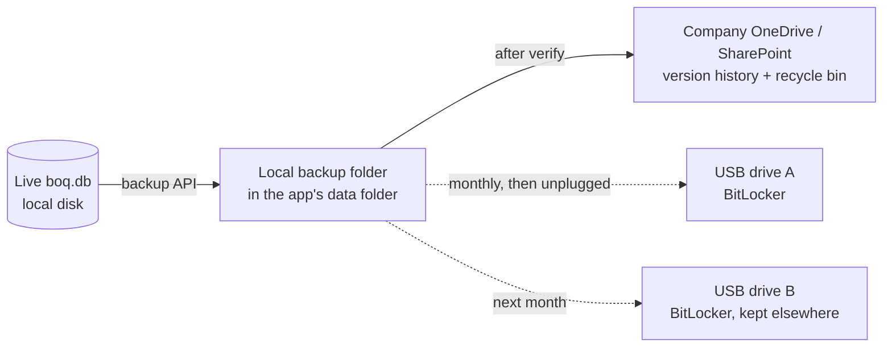

- **3** copies: live, local backup, off-site.
- **2** kinds of storage: internal disk, cloud / USB.
- **1** off-site: company OneDrive / SharePoint (not a personal account).
- **1** offline: USB drive, unplugged, two drives alternating.
- **0** errors: every backup is verified.

### 10.6 Verifying a backup

1. Open the copy and run `PRAGMA integrity_check`.
2. Compare per project: number of bills and receipts, total billed, total received, total paid.
3. Write a manifest beside the backup: date, app version, schema version, counts, totals, SHA-256.
4. Mark it verified. If any check fails, warn and keep the previous verified backups.

### 10.7 Restoring

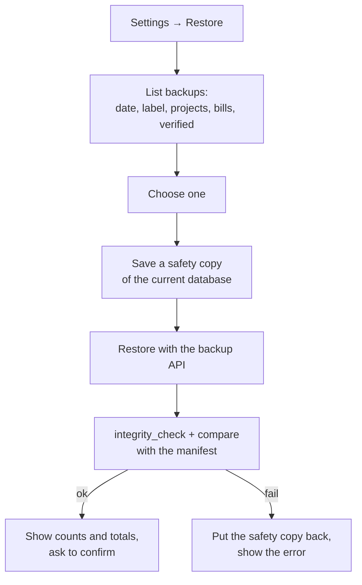

**One-page runbook if the PC is lost:** install the `.exe` on any Windows PC → copy the latest verified backup from OneDrive (or USB) → Restore from file → check counts and totals against the manifest → carry on. Target: 30–60 minutes.

**Practice:** a test restore on a spare PC every quarter (first Saturday of the quarter), with the time taken written down.

### 10.8 Who does what

| Role | Task |
|---|---|
| Data-entry person | Presses **Finish & back up** every Saturday; swaps the USB drive monthly |
| Owner / admin | Owns the OneDrive folder and access, keeps the runbook, runs the quarterly test restore |
| The app | Warns if there is no verified off-site backup for more than 2 sessions |

---

## 11. Security and access

| Area | Phase A (SQLite, one PC) | Phase B (server) |
|---|---|---|
| Who can open the data | Windows login of that PC; BitLocker on the disk | Personal logins; passwords hashed; optional Microsoft 365 sign-in |
| Roles | Not needed | `owner` (everything, margin), `accounts` (payments, receipts), `site` (enter bills on assigned projects), `viewer` (read only, no margin) |
| Data in transit | — | HTTPS only |
| Data at rest | BitLocker; backups on company OneDrive and BitLocker USB | Encrypted disk and backups (managed by the cloud provider, or by IT on-prem) |
| Cost and margin | Shown to the PC user | Hidden from `site` and `viewer` roles; the internal report needs `owner` |
| History | Audit log | Audit log with user names; read-only for everyone except `owner` |
| Personal data | Client contacts only | Keep in an Indian region; follow India's DPDP Act (purpose, access, deletion on request) |

---

## 12. Migrating from SQLite to PostgreSQL

### 12.1 How hard is it?

| If we follow the rules below from day one | If SQLite shortcuts spread through the code |
|---|---|
| **2–5 days** of work: run the migrations on PostgreSQL, copy the data, verify, switch the data layer | **2–4 weeks**: fix types, rewrite queries, clean bad data PostgreSQL refuses |

### 12.2 Rules from day one

| Rule | Why |
|---|---|
| All SQL lives in the data layer (`repo_sqlite.py`); screens and calculations never write SQL | Only one module changes |
| `STRICT` tables in SQLite (SQLite 3.37+; the build PC has 3.50) | SQLite stops accepting the wrong type, like PostgreSQL |
| `PRAGMA foreign_keys=ON`, `CHECK` constraints, `NOT NULL` where it must be | Bad data is refused now, not discovered during the move |
| Money in paise (`INTEGER` → `BIGINT`) | Exact, and the same in both |
| Quantities as decimal text (→ `NUMERIC(14,3)`) | Exact, no floating-point drift |
| Dates as ISO text `YYYY-MM-DD` (→ `DATE`), times as UTC ISO text (→ `TIMESTAMPTZ`) | No date-function differences |
| App-generated ULID text IDs (→ `TEXT` or `UUID`) | No auto-increment differences; offline records merge cleanly |
| Standard SQL only: no `INSERT OR REPLACE`, no SQLite date functions, no `rowid` | Same queries run on both |
| Booleans as `INTEGER 0/1` with a `CHECK` (→ `BOOLEAN`) | Clear mapping |
| Numbered migration scripts plus a `schema_version` table | The same history replays on PostgreSQL |
| Use `?` placeholders only inside the data layer | The PostgreSQL layer switches to `%s` in one place |

### 12.3 Steps

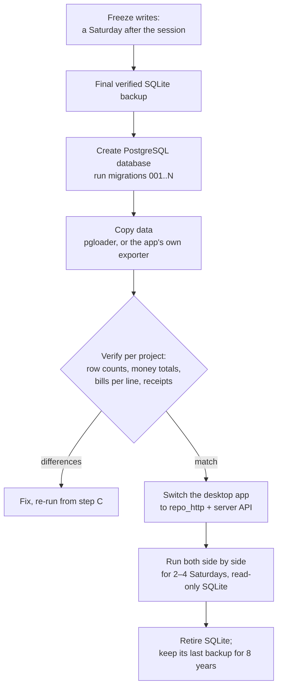

### 12.4 What changes in the code

| Part | Change |
|---|---|
| Screens, calculations | None |
| `repo_sqlite.py` | Kept for offline use and tests |
| New `repo_http.py` (desktop) | Calls the server API with `urllib` (standard library) |
| New server: API + `repo_postgres.py` | Same interface, PostgreSQL driver (`psycopg`) on the server only |
| Migrations | Same numbered scripts, PostgreSQL types (Appendix B) |
| Offline queue | Today's "Not yet in Excel" queue becomes "Not yet synced" and pushes when online |

### 12.5 MySQL instead

Possible with the same rules. Differences to plan for: use `DECIMAL` and `BIGINT`, `utf8mb4` everywhere, InnoDB, strict SQL mode on, and schema changes are not transactional (take a backup before each migration).

---

## 13. Cost comparison

> Approximate figures from typical public list prices, converted at about ₹85–88 per US$, excluding GST. Prices change; check current pricing before deciding. Development cost is not included; it is the same for every option.

### 13.1 Now: 1–5 users, up to about 50 projects

| Option | One-time | Monthly | Year 1 | Later years |
|---|---|---|---|---|
| **SQLite on one PC** | ₹0–5k (USB drives) | ~₹0 | ≤ ₹5k | ~₹0 |
| **Cloud PostgreSQL that pauses when idle** (serverless) + free-tier API host | ₹0 | ₹0–1,500 | ₹0–18k | ₹0–18k |
| **Cloud: small managed PostgreSQL + small API server** (Indian region) | ₹0 | ₹1,800–3,200 | ₹22k–38k | ₹22k–38k |
| **On-prem: mini server + UPS + backup NAS**, Linux and PostgreSQL (free) | ₹60k–1.25L | ₹2.5k–7k (power, static IP / VPN, 2–4 h IT time) | ₹90k–2L | ₹30k–85k |

### 13.2 Grown: 50–200 users, many projects or branches

| Option | Yearly (approx.) | Notes |
|---|---|---|
| **Cloud**: highly available PostgreSQL, read replica, 2+ API servers, monitoring | ₹3–8L | No hardware; part-time cloud skills needed |
| **On-prem**: 2 servers for redundancy, rack / UPS, off-site backup | ₹3–6L hardware every ~5 years + **₹6–15L a year** sysadmin / DBA | Staff is the largest cost; you own disaster recovery |

### 13.3 Five-year view (1–5 users)

| Option | 5-year total (approx.) |
|---|---|
| SQLite on one PC | ₹5–10k |
| Cloud, serverless | ₹0–90k |
| Cloud, small managed | ₹1.1–1.9L |
| On-prem, small | ₹2.1–5.4L |

### 13.4 Costs that are easy to miss

- Building the API, logins and screens (largest one-time cost, any option).
- Someone who owns updates, backups and access, even part-time.
- A tested restore (time each quarter).
- Data protection obligations for client and money data (DPDP Act); keep data in an Indian region.

**Recommendation:** cloud is cheaper and safer than on-prem at every size until there is an in-house IT team. On-prem only makes sense with a firm "data must stay in our building" rule and staff to run it.

---

## 14. Saturday-only use

| Effect | What we do |
|---|---|
| Load is tiny (one session a week) | No performance work needed; size is not a reason to move |
| Serverless cloud databases pause when idle | Cheapest cloud option; the first connection on Saturday may take a few seconds |
| A 2 a.m. nightly backup is useless if the PC is off | Backup runs on **Finish & back up** and on closing the app |
| A problem found on Saturday morning blocks the whole week's entry | Friday health check (cloud: automated; SQLite: the app's start check); support contact on Saturdays |
| Updates and maintenance | **Never on Saturday.** App and server updates go out mid-week |
| On-prem server | Only needs to be on Saturdays, but must be switched on and reachable |

---

## 15. Migrating today's Excel trackers

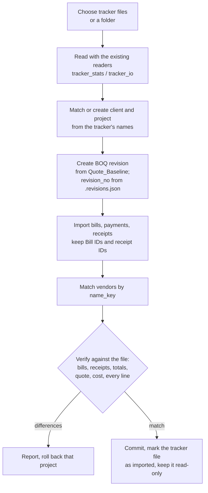

- Runs one project per transaction; a failed project does not affect the others.
- The tracker files are not changed; they are kept as the record of the old system.
- `.changes.csv` rows are imported into `audit_log` (marked as imported history).
- Run the old and new side by side for 2–4 Saturdays: enter in the app, compare the exported Excel with the old figures.

---

## 16. Testing

| Kind | What |
|---|---|
| Unit | Each repository call; money and quantity conversions (paise, `Decimal`); version conflict refused |
| Calculations | The existing test files (`test_update`, `test_diff`, `test_faq`, `test_stagecash`, …) run against the SQLite data layer and must give the same figures as from Excel |
| Import | Every demo tracker imported; counts and totals match the file exactly |
| Revision | Unchanged BOQ → no change; removed line → orphan decision required; rollback on a failed verify; undo |
| Backup / restore | Backup verifies; corrupted backup is detected; restore + safety copy; restore on a clean PC |
| Migration rehearsal | SQLite → PostgreSQL in a test environment, verified per project, before the real move |
| Security (Phase B) | Roles hide margin; tokens expire; HTTPS only |

---

## 17. Phased plan

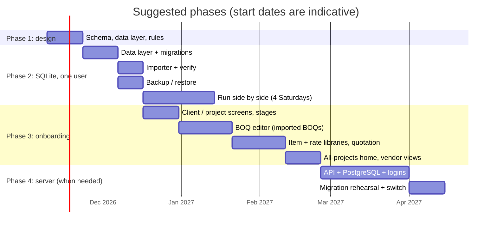

| Phase | What | Move on when |
|---|---|---|
| 1. Design | Schema, portability rules, repository interface, migration scripts | Review signed off |
| 2. SQLite, one user | Data layer, importer with verification, backup / restore, Excel export; app becomes the entry point | 4 Saturdays with figures matching the old trackers |
| 3. Onboarding and BOQ editor | Client → Project → BOQ screens; editable stages from the company template; BOQ editor for imported BOQs (edit, check, sign, revise); then item and rate libraries and "create from scratch"; client quotation export; all-projects home | — |
| 4. Server | PostgreSQL behind an API, logins and roles, audit with users, offline sync | **Any** of: a 2nd person entering data; entry from more than one PC or site; roles needed; data must not live on one laptop |
| 5. Scale | High availability, read replica, branches, bill photos, mobile entry, approvals | Users or sites grow |

---

## 18. Risks

| Risk | Impact | Mitigation |
|---|---|---|
| People keep typing in Excel after the switch | Two versions of the truth | Excel export is read-only and says so; Help page and training |
| Live database put in a synced folder | Corruption | App refuses to open a database inside OneDrive / Dropbox / Google Drive folders |
| Import differences go unnoticed | Wrong figures | Per-project verification; side-by-side Saturdays |
| SQLite shortcuts creep in | Costly PostgreSQL move | Rules in section 12.2; CI test that runs migrations on PostgreSQL |
| No one owns backups | Data loss | App warning after 2 sessions without off-site copy; quarterly restore test on the calendar |
| Server down on a Saturday | A week's entry delayed | Offline queue; mid-week updates only; Friday check |
| Cost grows unnoticed in the cloud | Budget | Billing alerts; serverless while usage is low |

---

## 19. Open questions

1. Do clients usually have **several projects**, or one each?
2. Once the app is the entry point, can the Excel tracker become **read-only**?
3. Must data stay **in-house**, or is an Indian-region cloud acceptable?
4. Who is the **admin**: an in-house person or an outside IT provider?
5. Should the client record carry **GSTIN, address and contacts** now (for invoices later)?
6. Is company **OneDrive / SharePoint** available for off-site backups?
7. Who swaps the USB drive and runs the quarterly test restore?
8. How long must closed-project data be kept (the accountant's rule)?
9. Should the client quotation show the labour / material breakdown, or only items with their rates?
10. Are rates the same across sites, or set per city / area in the rate library?

---

## Appendix A: SQLite DDL

First migration (`001_initial.sql`). Written for SQLite `STRICT` tables using only portable types, so the PostgreSQL version is a type swap (Appendix B).

```sql
PRAGMA foreign_keys = ON;

CREATE TABLE schema_version (
  version     INTEGER NOT NULL PRIMARY KEY,
  applied_at  TEXT    NOT NULL                     -- UTC ISO 8601
) STRICT;

CREATE TABLE organization (
  org_id      TEXT NOT NULL PRIMARY KEY,           -- ULID
  name        TEXT NOT NULL,
  created_at  TEXT NOT NULL
) STRICT;

CREATE TABLE branch (
  branch_id   TEXT NOT NULL PRIMARY KEY,
  org_id      TEXT NOT NULL REFERENCES organization(org_id),
  name        TEXT NOT NULL,
  city        TEXT
) STRICT;

CREATE TABLE client (
  client_id   TEXT NOT NULL PRIMARY KEY,
  org_id      TEXT NOT NULL REFERENCES organization(org_id),
  code        TEXT NOT NULL,                       -- CL-0001
  name        TEXT NOT NULL,
  gstin       TEXT,
  address     TEXT,
  status      TEXT NOT NULL DEFAULT 'active' CHECK (status IN ('active', 'archived')),
  created_at  TEXT NOT NULL,
  UNIQUE (org_id, code)
) STRICT;

CREATE TABLE client_contact (
  contact_id  TEXT NOT NULL PRIMARY KEY,
  client_id   TEXT NOT NULL REFERENCES client(client_id),
  name        TEXT NOT NULL,
  phone       TEXT,
  email       TEXT,
  role        TEXT
) STRICT;

CREATE TABLE app_user (
  user_id     TEXT NOT NULL PRIMARY KEY,
  org_id      TEXT NOT NULL REFERENCES organization(org_id),
  name        TEXT NOT NULL,
  email       TEXT NOT NULL UNIQUE,
  role        TEXT NOT NULL CHECK (role IN ('owner', 'accounts', 'site', 'viewer')),
  status      TEXT NOT NULL DEFAULT 'active' CHECK (status IN ('active', 'disabled'))
) STRICT;

CREATE TABLE stage_template (                     -- the company's default stage list
  org_id      TEXT    NOT NULL REFERENCES organization(org_id),
  stage_code  TEXT    NOT NULL,                    -- ST01..ST10, more can be added
  name        TEXT    NOT NULL,
  sort_order  INTEGER NOT NULL,
  PRIMARY KEY (org_id, stage_code)
) STRICT;

CREATE TABLE project (
  project_id     TEXT NOT NULL PRIMARY KEY,
  client_id      TEXT NOT NULL REFERENCES client(client_id),
  branch_id      TEXT REFERENCES branch(branch_id),
  code           TEXT NOT NULL,                    -- PRJ-2026-014
  name           TEXT NOT NULL,
  site_address   TEXT,
  status         TEXT NOT NULL DEFAULT 'active' CHECK (status IN ('planned', 'active', 'closed')),
  start_date     TEXT,                             -- YYYY-MM-DD
  end_date       TEXT,
  current_boq_id TEXT,                             -- set after the first revision is saved
  created_at     TEXT NOT NULL,
  UNIQUE (client_id, code)
) STRICT;

CREATE TABLE project_member (
  project_id  TEXT NOT NULL REFERENCES project(project_id),
  user_id     TEXT NOT NULL REFERENCES app_user(user_id),
  role        TEXT NOT NULL CHECK (role IN ('owner', 'accounts', 'site', 'viewer')),
  PRIMARY KEY (project_id, user_id)
) STRICT;

CREATE TABLE boq_revision (
  boq_id        TEXT    NOT NULL PRIMARY KEY,
  project_id    TEXT    NOT NULL REFERENCES project(project_id),
  revision_no   INTEGER NOT NULL CHECK (revision_no >= 1),
  status        TEXT    NOT NULL CHECK (status IN ('draft', 'signed', 'superseded')),
  signed_on     TEXT,
  source_file   TEXT    NOT NULL,                  -- original file name
  source_sha256 TEXT    NOT NULL,
  quote_paise   INTEGER NOT NULL,
  cost_paise    INTEGER NOT NULL,
  created_by    TEXT REFERENCES app_user(user_id),
  created_at    TEXT    NOT NULL,
  UNIQUE (project_id, revision_no)
) STRICT;

CREATE TABLE boq_stage (                          -- each revision's own stage list (copied from the template)
  boq_id      TEXT    NOT NULL REFERENCES boq_revision(boq_id),
  stage_code  TEXT    NOT NULL,
  name        TEXT    NOT NULL,
  sort_order  INTEGER NOT NULL,
  PRIMARY KEY (boq_id, stage_code)
) STRICT;

CREATE TABLE boq_line (
  line_id        TEXT    NOT NULL PRIMARY KEY,
  boq_id         TEXT    NOT NULL REFERENCES boq_revision(boq_id),
  item_code      TEXT    NOT NULL,                 -- SIT001, MAT001, EXTRA
  parent_line_id TEXT REFERENCES boq_line(line_id),
  level          INTEGER NOT NULL CHECK (level IN (0, 1)),
  stage_code     TEXT,
  section        TEXT,
  description    TEXT    NOT NULL,
  unit           TEXT,
  qty            TEXT,                             -- decimal as text; typed on an item, calculated on a line
  cons_per_unit  TEXT,                             -- line only: e.g. '0.095' bags per Cu.Ft of its item
  wastage_bp     INTEGER NOT NULL DEFAULT 0,       -- basis points: 500 = 5 %
  rate_paise     INTEGER,
  profit_bp      INTEGER NOT NULL DEFAULT 0,       -- basis points: 1200 = 12 %
  quoted_paise   INTEGER NOT NULL,
  cost_paise     INTEGER NOT NULL,
  bill_target    INTEGER NOT NULL CHECK (bill_target IN (0, 1)),
  sort_order     INTEGER NOT NULL,
  UNIQUE (boq_id, item_code),
  FOREIGN KEY (boq_id, stage_code) REFERENCES boq_stage (boq_id, stage_code)
) STRICT;
CREATE INDEX ix_boq_line_stage ON boq_line (boq_id, stage_code);

CREATE TABLE vendor (
  vendor_id   TEXT NOT NULL PRIMARY KEY,
  org_id      TEXT NOT NULL REFERENCES organization(org_id),
  name        TEXT NOT NULL,
  name_key    TEXT NOT NULL,                       -- lower case, single spaces
  gstin       TEXT,
  phone       TEXT,
  UNIQUE (org_id, name_key)
) STRICT;

CREATE TABLE bill (
  bill_id      TEXT    NOT NULL PRIMARY KEY,       -- existing APP-... IDs kept
  project_id   TEXT    NOT NULL REFERENCES project(project_id),
  item_code    TEXT    NOT NULL,
  boq_id       TEXT    NOT NULL REFERENCES boq_revision(boq_id),
  vendor_id    TEXT REFERENCES vendor(vendor_id),
  bill_no      TEXT,
  bill_date    TEXT,                               -- YYYY-MM-DD
  qty          TEXT    NOT NULL,
  rate_paise   INTEGER NOT NULL,
  amount_paise INTEGER NOT NULL,
  pay_status   TEXT CHECK (pay_status IN ('Unpaid', 'Part paid', 'Paid')),
  entered_by   TEXT REFERENCES app_user(user_id),
  version      INTEGER NOT NULL DEFAULT 1,
  deleted_at   TEXT,
  created_at   TEXT    NOT NULL,
  updated_at   TEXT    NOT NULL
) STRICT;
CREATE INDEX ix_bill_line   ON bill (project_id, item_code);
CREATE INDEX ix_bill_date   ON bill (project_id, bill_date);
CREATE INDEX ix_bill_vendor ON bill (vendor_id);

CREATE TABLE bill_payment (
  payment_id   TEXT    NOT NULL PRIMARY KEY,
  bill_id      TEXT    NOT NULL REFERENCES bill(bill_id),
  paid_on      TEXT    NOT NULL,
  amount_paise INTEGER NOT NULL CHECK (amount_paise > 0),
  method       TEXT,
  reference    TEXT
) STRICT;

CREATE TABLE client_receipt (
  receipt_id   TEXT    NOT NULL PRIMARY KEY,
  project_id   TEXT    NOT NULL REFERENCES project(project_id),
  received_on  TEXT    NOT NULL,
  amount_paise INTEGER NOT NULL CHECK (amount_paise > 0),
  reference    TEXT,
  note         TEXT,
  version      INTEGER NOT NULL DEFAULT 1,
  deleted_at   TEXT
) STRICT;
CREATE INDEX ix_receipt_date ON client_receipt (project_id, received_on);

CREATE TABLE attachment (
  attachment_id TEXT NOT NULL PRIMARY KEY,
  project_id    TEXT NOT NULL REFERENCES project(project_id),
  owner_type    TEXT NOT NULL CHECK (owner_type IN ('bill', 'boq', 'receipt')),
  owner_id      TEXT NOT NULL,
  file_name     TEXT NOT NULL,
  sha256        TEXT NOT NULL,
  storage_path  TEXT NOT NULL
) STRICT;

CREATE TABLE audit_log (
  audit_id    TEXT NOT NULL PRIMARY KEY,
  at          TEXT NOT NULL,                       -- UTC
  user_id     TEXT REFERENCES app_user(user_id),
  action      TEXT NOT NULL CHECK (action IN ('add', 'edit', 'delete', 'move', 'restore', 'revision', 'import')),
  entity      TEXT NOT NULL,
  entity_id   TEXT NOT NULL,
  project_id  TEXT,
  before_json TEXT,
  after_json  TEXT,
  reason      TEXT
) STRICT;
CREATE INDEX ix_audit_project ON audit_log (project_id, at);
CREATE INDEX ix_audit_entity  ON audit_log (entity, entity_id);

INSERT INTO schema_version (version, applied_at) VALUES (1, strftime('%Y-%m-%dT%H:%M:%SZ', 'now'));
```

> The last line uses an SQLite date function only inside the migration script, which is rewritten per database anyway. Application code never does.

---

## Appendix B: SQLite → PostgreSQL type map

| Meaning | SQLite (STRICT) | PostgreSQL | MySQL 8 |
|---|---|---|---|
| ID (ULID) | `TEXT` | `TEXT` (or `UUID` if switched) | `CHAR(26)` |
| Money (paise) | `INTEGER` | `BIGINT` | `BIGINT` |
| Quantity | `TEXT` (decimal) | `NUMERIC(14,3)` | `DECIMAL(14,3)` |
| Profit (basis points) | `INTEGER` | `INTEGER` | `INT` |
| Date | `TEXT` `YYYY-MM-DD` | `DATE` | `DATE` |
| Timestamp | `TEXT` UTC ISO | `TIMESTAMPTZ` | `DATETIME(6)` (store UTC) |
| Yes / no | `INTEGER` 0/1 + `CHECK` | `BOOLEAN` | `TINYINT(1)` |
| JSON (audit) | `TEXT` | `JSONB` | `JSON` |
| Short choice | `TEXT` + `CHECK` | `TEXT` + `CHECK` | `VARCHAR` + `CHECK` |
| Placeholder in code | `?` | `%s` (psycopg) | `%s` |

---

## Appendix C: glossary

| Term | Meaning |
|---|---|
| **Signed BOQ** | The final BOQ the client agreed to; revision 1 of a project |
| **BOQ revision** | A later version of the BOQ; the previous one is kept as superseded |
| **Budget / quoted cost** | Quote without profit: quoted amount ÷ (1 + profit %) |
| **Rate analysis** | A BOQ item described by what one unit consumes (materials and labour per unit, plus wastage); line quantities follow the item quantity |
| **Stage template** | The company's default stage list (ST01–ST10) that a new BOQ starts with |
| **Bill-taking line** | A lowest-level line that can receive a bill (labour / material lines, items with no lines, EXTRA, REWORK, OVERHEAD) |
| **Orphan bill** | A bill whose line no longer exists (or no longer takes bills) in a revised BOQ |
| **Paise** | 1/100 of a rupee; money is stored as whole paise |
| **WAL** | SQLite's write-ahead log mode: safer against crashes |
| **RPO / RTO** | How much data may be lost / how long recovery may take |
| **ULID** | A unique, time-sortable ID that can be generated offline |
| **Serverless database** | A cloud database that pauses when idle and is billed for use |
| **DPDP Act** | India's Digital Personal Data Protection Act, 2023 |
